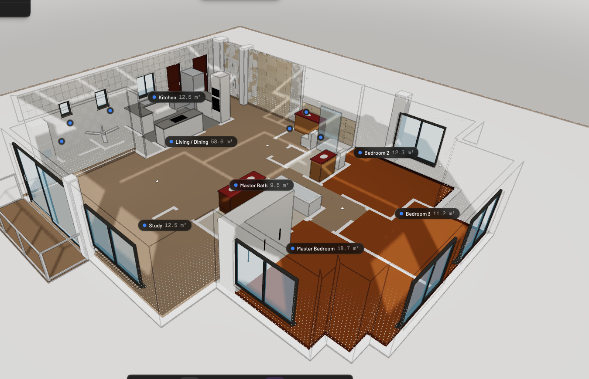

# Maplewoods, Chempaka Court · Type D1 in 3D

An interactive 3D model of a Type D1 unit at Maplewoods, Chempaka Court, Singapore.

**Live viewer:** https://junglebabydev.github.io/maplewoods-3d/

## What's in it

1. Every wall, door and window traced from the developer brochure plan, scaled so the room areas match the brochure (for example Bedroom 3 is 10.00 m²).
2. Finishes from a walkthrough video: polished marble in the living, dining and study; teak basketweave parquet in the bedrooms; a white-tiled kitchen; red marble vanities.
3. Fixed fittings only: kitchen cabinets, fridge, washer and dryer, bathroom fittings, master wardrobe, living-room fan. No loose furniture.

## Viewer controls

- Drag to rotate, scroll or pinch to zoom, right-drag to pan.
- Preset views: Overview, Top, Living, Kitchen, Master.
- **Cut walls** slices everything above 1.3 m so you can see into the rooms.

## Estimates

- Ceiling height 2.8 m, plus door and window sizes, are estimates.
- The main door position is a best read of the brochure.
- The A/C ledge and outside planter ledges are not modelled.
- Orientation follows the brochure page, not true north.

## How it was made

- Modelled with [Pascal Editor](https://github.com/pascalorg/editor) through its MCP `author_scene` tool. `source/generate-scene.mjs` builds the scene payload from the traced plan.
- `source/maplewoods-type-d1.pascal.json` is the exported Pascal scene.
- `model.glb` was exported from Pascal's renderer. The viewer is plain [three.js](https://threejs.org) (vendored in `vendor/`, MIT licence).

| Folder | Contents |
| --- | --- |
| `index.html`, `model.glb`, `vendor/` | The web viewer |
| `renders/` | Still renders and Pascal's 2D plan |
| `source/` | Pascal scene file and the generator script |
