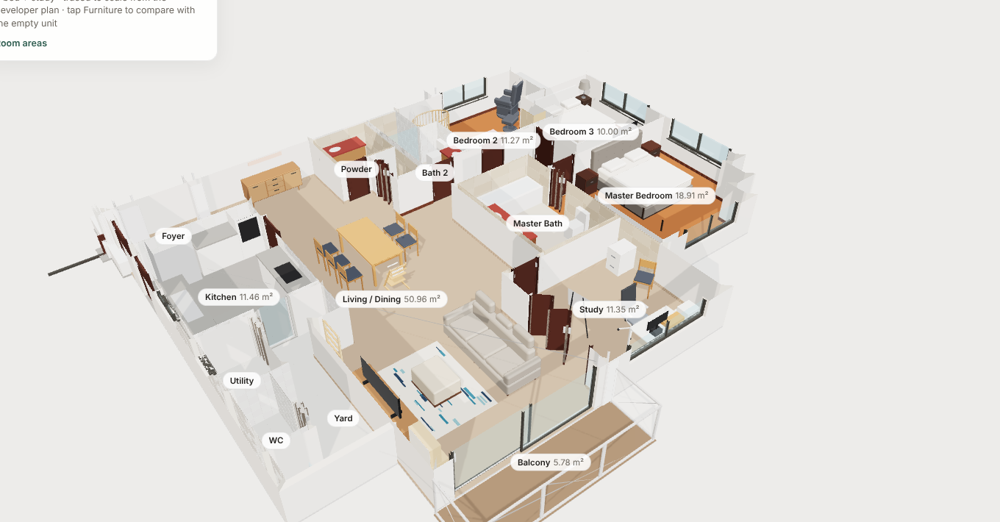

# Maplewoods, Chempaka Court · Type D1 in 3D

An interactive 3D model of a Type D1 unit at Maplewoods, Chempaka Court, Singapore.

**Live viewer:** https://junglebabydev.github.io/maplewoods-3d/

## What's in it

1. Every wall, door and window traced from the developer brochure plan, scaled so the room areas match the brochure (for example Bedroom 3 is 10.00 m²).
2. Finishes from a walkthrough video: polished marble in the living, dining and study; teak basketweave parquet in the bedrooms; a white-tiled kitchen; red marble vanities.
3. Fixed fittings only: kitchen cabinets, fridge, washer and dryer, bathroom fittings, master wardrobe, living-room fan. No loose furniture.

## Furniture layout

Tap **Furniture** in the viewer to switch between the furnished and the empty unit. Add `?furniture=0` to the link to open it empty.

| Room | Pieces | Size used |
| --- | --- | --- |
| Living | 3-seater sofa, ottoman, rug, acacia TV console (HipVan), 65" TV, wall ladder, play kitchen | Sofa 240 x 95 cm; console about 200 x 45 cm (estimate) |
| Dining | IKEA EKEDALEN extendable table, 5 chairs, Tripp Trapp high chair, Castlery Seb sideboard with canvas | Table 180 (240 extended) x 90 x 75 cm; sideboard 160 x 45 x 78 cm |
| Master bedroom | IKEA king upholstered storage bed, 2 nightstands | About 197 x 224 cm (estimate, 180x200 mattress) |
| Bedroom 2 (nursery) | Oval crib with canopy, kids' wardrobe, book display, play mat, glider and ottoman | Estimated from photos |
| Bedroom 3 | IKEA MALM queen, nightstand with lamp, TV on stand | MALM 176 x 209 cm, 100 cm headboard |
| Study | White desk with monitor, printer cart, mesh office chair, side chair, filing cabinet, whiteboard | Estimated from photos |

Pieces are modelled as clean shapes from photos, without bedding clutter or personal items. Where a size could not be found it is estimated, so allow about 10 cm either way. The furniture lives in `furniture.js`, separate from the Pascal model.

## Viewer controls

- Drag to rotate, scroll or pinch to zoom, right-drag to pan.
- **2D plan** shows the floor plan flat: a drawn plan with your furniture (follows the furniture and labels buttons), or the original developer brochure. Drag to move, scroll or pinch to zoom, double-click to fit. Link straight to it with `?view=2d`.
- Preset views: Overview, Top, Living, Kitchen, Master.
- **Furniture** shows or hides your furniture.
- **Cut walls** slices everything above 1.3 m so you can see into the rooms.

## Estimates

- Ceiling height 2.8 m, plus door and window sizes, are estimates.
- The main door position is a best read of the brochure.
- The A/C ledge and outside planter ledges are not modelled.
- Orientation follows the brochure page, not true north.

## How it was made

- Modelled with [Pascal Editor](https://github.com/pascalorg/editor) through its MCP `author_scene` tool. `source/generate-scene.mjs` builds the scene payload from the traced plan.
- `source/maplewoods-type-d1.pascal.json` is the exported Pascal scene.
- `model.glb` was exported from Pascal's renderer. The viewer is plain [three.js](https://threejs.org) (vendored in `vendor/`, MIT licence).

| Folder | Contents |
| --- | --- |
| `index.html`, `model.glb`, `furniture.js`, `vendor/` | The web viewer and the furniture layer |
| `renders/` | Still renders and Pascal's 2D plan |
| `source/` | Pascal scene file and the generator script |

## 2D plan files

- `plan.svg` is drawn from the brochure trace with [Floorimate](https://github.com/junglebabydev/floorplay)'s plan geometry, so walls, doors and furniture line up with the 3D model. Regenerate it with `source/make-plan.mts` (instructions at the top of the file).
- `brochure.jpg` is the developer's brochure plan as published on the listing site, including its watermarks.
